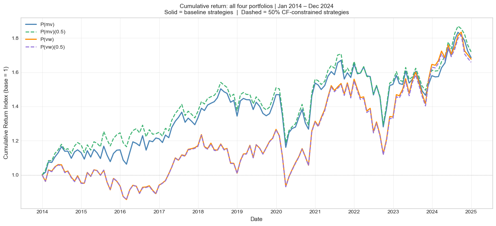
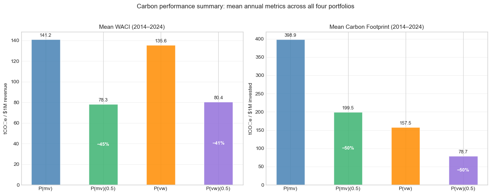

# Sustainable Portfolio Allocation: Decarbonising European Equities

*Sustainable & Entrepreneurial Finance (FIN-429), EPFL. Group project, Parts 1 & 2 combined*

How much return and risk does an investor give up to **halve the carbon footprint** of a European equity portfolio? This project builds the whole pipeline: from raw Datastream data to out-of-sample minimum-variance portfolios, and then to two decarbonisation strategies, one **active** and one **passive**.

📓 **Notebook:** [`sustainable_portfolio_allocation.ipynb`](sustainable_portfolio_allocation.ipynb) (one end-to-end, reproducible pipeline)
📄 **Reports:** [Part 1: portfolio allocation](reports/Part1_Portfolio_Allocation_Report.pdf) · [Part 2: carbon-aware allocation](reports/Part2_Carbon_Aware_Allocation_Report.pdf) · [Sales pitch: decarbonised index](reports/Sales_Pitch.pdf)

## What the pipeline does

**Part I: Allocation on financial objectives**
1. **Universe and cleaning.** European firms with Scope 1 & 2 CO₂ data, a point-in-time eligibility lag, removal of low and stale prices, and a minimum-history filter.
2. **Investment sets.** Rolling 10-year estimation windows for every investment year from 2014 to 2025.
3. **Benchmarks.** Equally-weighted and value-weighted portfolios, plus the in-sample efficient frontier and capital allocation line.
4. **Out-of-sample minimum variance.** A long-only P(mv), re-estimated every year from 2014 to 2024 with buy-and-hold weight drift, against a VW benchmark P(vw).

**Part II: Carbon-aware allocation**
1. **Carbon metrics.** Carbon intensity (Scope 1+2 per $M revenue), **WACI** and **carbon footprint** (tCO₂e per $M invested) for both baselines, plus the top contributors.
2. **Active decarbonisation, P(mv)(0.5).** Minimum variance subject to CF ≤ 50 % of the baseline, every year.
3. **Passive decarbonisation, P(vw)(0.5).** Tracking error to the VW benchmark is minimised subject to the same 50 % CF cap, in line with the EU Paris-Aligned Benchmark logic.
4. **Extended evaluation.** Tracking error, information ratio, CAPM alpha with t-statistics, rolling Sharpe and beta, drawdowns, carbon-efficiency, turnover and transaction costs.

## Results (out-of-sample, 2014–2024, 132 months)

| | P(mv) | P(mv)(0.5) | P(vw) | P(vw)(0.5) |
|---|---|---|---|---|
| Annual return | 5.74 % | 5.85 % | 6.07 % | 5.95 % |
| Annual volatility | 14.03 % | 13.53 % | 16.51 % | 16.44 % |
| Sharpe ratio | 0.300 | 0.320 | 0.275 | 0.269 |
| Max drawdown | −23.3 % | −24.2 % | −28.0 % | −27.9 % |
| Mean WACI (tCO₂e/$M rev) | 141.2 | 78.3 | 135.6 | 80.4 |
| Mean carbon footprint (tCO₂e/$M inv) | 398.9 | 199.5 | 157.5 | 78.7 |
| Tracking error vs. own baseline | | 2.08 % | | **0.25 %** |

**Takeaways**
- Carbon is extremely concentrated: a handful of high-intensity firms drive most of the portfolio's WACI. As a result, a **50 % footprint cut costs almost nothing** in risk-adjusted terms.
- The passive strategy achieves the 50 % cut every year with **0.25 % tracking error** and an **≈11 bp** annual return drag. The WACI reduction of about 41 % comes as a free by-product.




## Repository structure

```
├── sustainable_portfolio_allocation.ipynb   # full pipeline: Part I (§1–2) and Part II (§3–5)
├── data/raw/                                # Datastream extracts provided by the course
│   ├── Static_2025.xlsx                     #   firm identifiers, country, region
│   ├── DS_CO2_SCOPE_{1,2}_Y_2025.xlsx       #   annual Scope 1 / Scope 2 emissions
│   ├── DS_RI_T_USD_M_2025.xlsx              #   monthly total-return index (USD)
│   ├── DS_MV_T_USD_{M,Y}_2025.xlsx          #   market capitalisation (monthly / annual)
│   ├── DS_REV_Y_2025.xlsx                   #   annual revenue
│   └── Risk_Free_Rate_2025.xlsx             #   monthly risk-free rate
├── figures/                                 # key charts exported from the notebook
└── reports/                                 # Part 1 & Part 2 reports, sales pitch
```

## How to run

```bash
pip install -r requirements.txt
jupyter notebook sustainable_portfolio_allocation.ipynb
```

Run it from the repository root. The notebook reads `data/raw/` and writes the generated investment sets to `output/`, which is git-ignored.
